<div align="center">


# Explore East Syria
### A bilingual, curated catalog of Syria's landmarks, places and culture

[](https://kotlinlang.org/)
[](https://developer.android.com/)
[](https://firebase.google.com/)
[](https://developers.google.com/maps)
[](https://material.io/)
[](#)

<br />

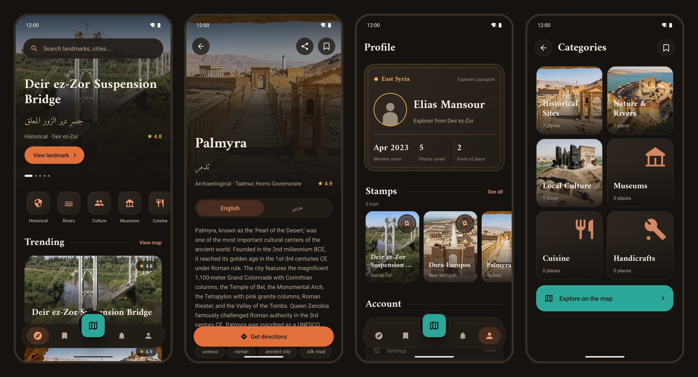

</div>

---

## Overview

**East Syria** is a native Android app built with Kotlin and Firebase, developed by [AhmadALSaffan](https://github.com/AhmadALSaffan). It is a catalog of Syrian landmarks and heritage sites (historical sites, rivers and nature, local culture, museums, cuisine and handicrafts) that lets a person discover a place, understand what it is, and find out how to visit it.

Every landmark is a **curated record, written in English and Arabic side by side**, with the practical facts a visitor needs: hours, entry fee, best time to visit and coordinates. Administrators maintain the catalog from inside the app, and unpublished drafts never reach visitors.

---

## Screenshots

### First run

An onboarding built from the catalog's own photographs, with drawn art over each: a pointed arch, a wall label holding a landmark's name in both scripts, a route to a pin, and a passport stamp.

| Horizon | Two languages | Come in |
|:---:|:---:|:---:|
| 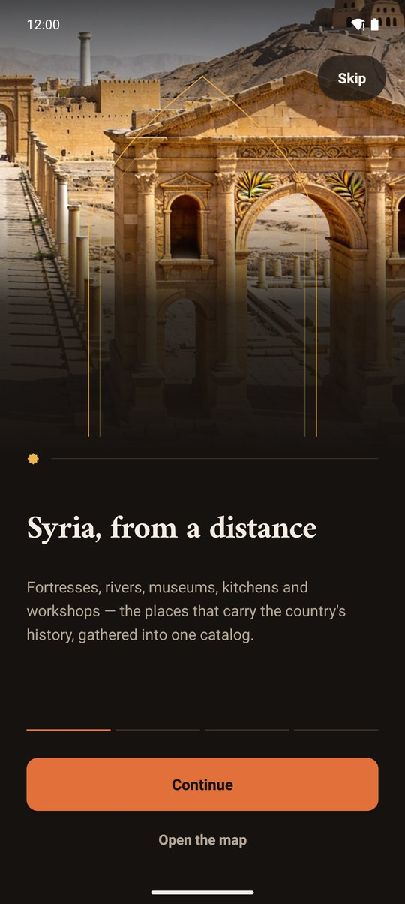 | 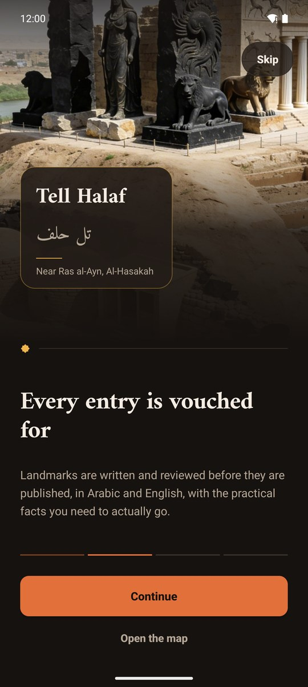 | 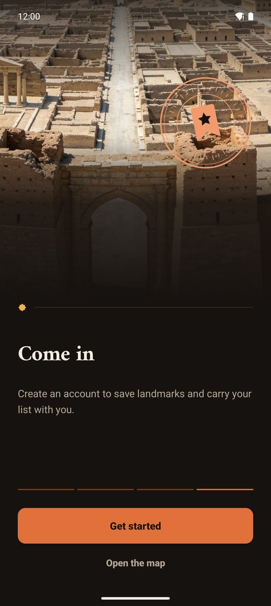 |

### Sign in and sign up

Outlined fields with a centred hint and an icon, terracotta focus, errors worded as what to do. The city list leads with the Syrian flag.

| Sign in | Sign up: city |
|:---:|:---:|
| 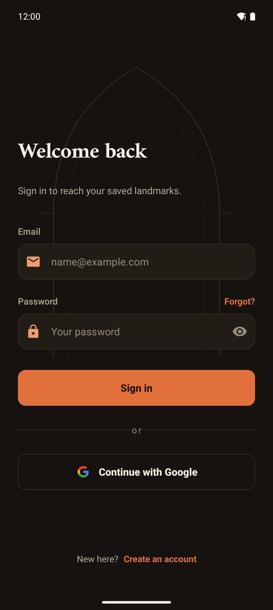 | 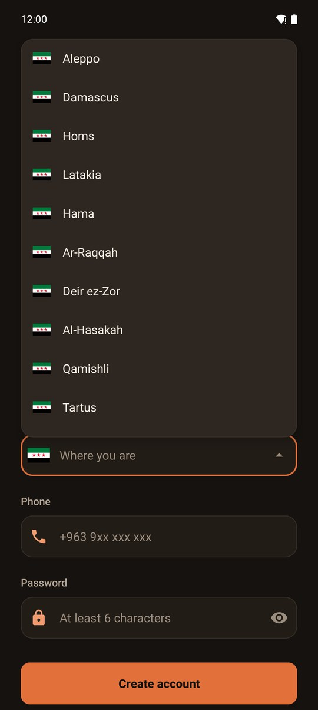 |

### Discover

| Home | Categories | Search | Map |
|:---:|:---:|:---:|:---:|
| 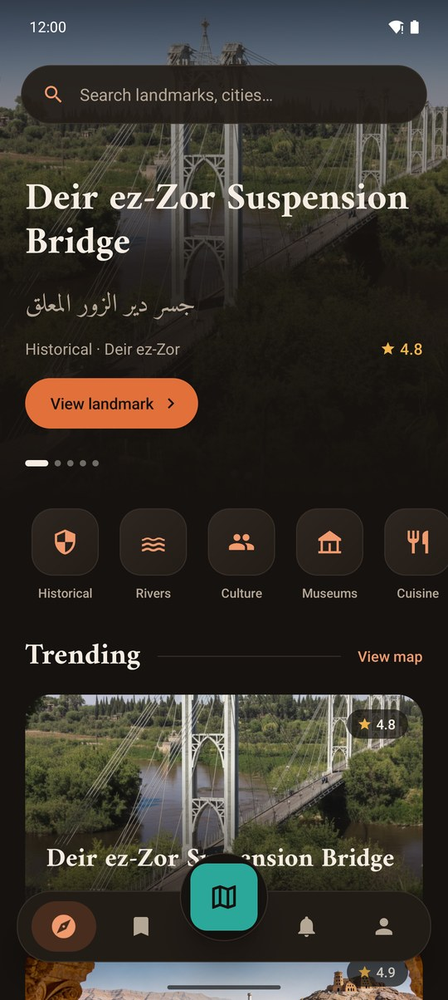 | 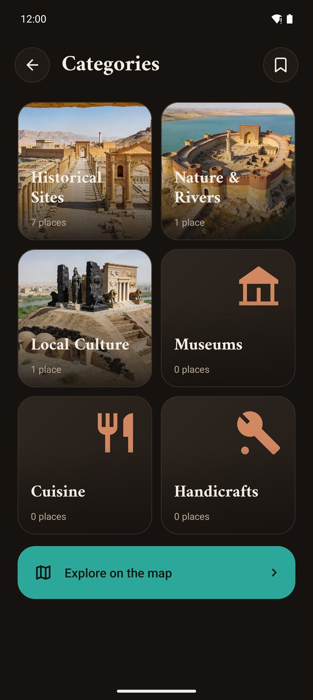 | 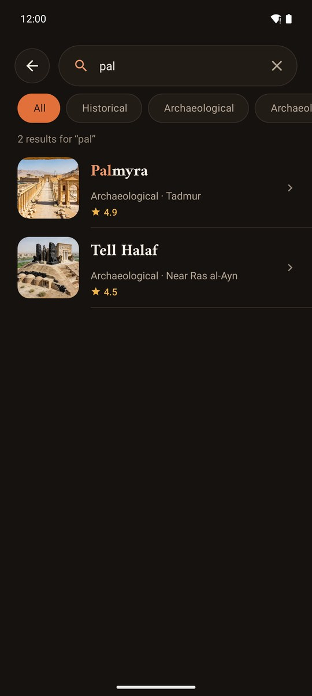 | 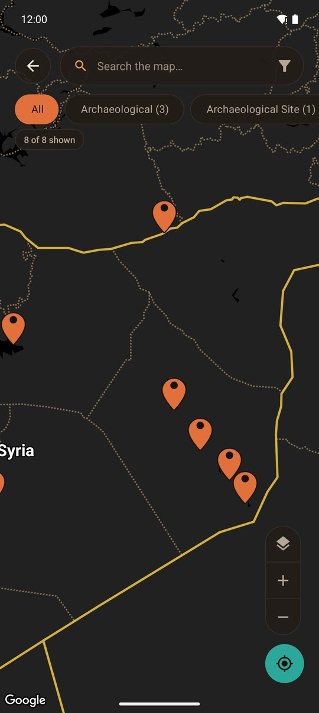 |

### A place, in both languages

| English | Arabic |
|:---:|:---:|
| 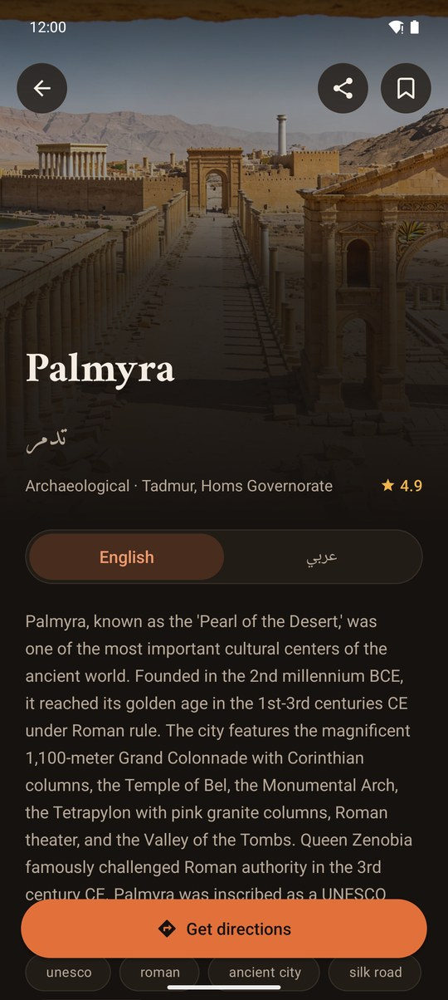 | 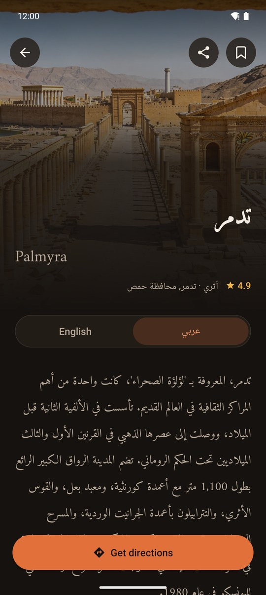 |

### Your passport and the curator

| Profile (sample data) | Curator dashboard |
|:---:|:---:|
| 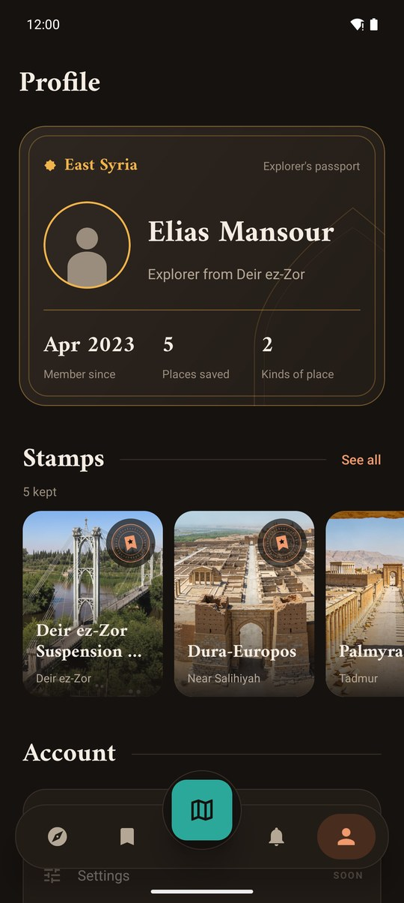 | 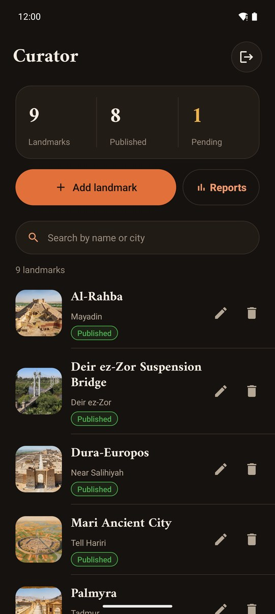 |

---

## Features

- 🏛️ **Photo-led home**: a full-bleed hero of featured landmarks, six categories, trending places and a floating search pill.
- 🌐 **Bilingual records**: every landmark is authored in English and Arabic, with a per-landmark language toggle; Arabic is set right to left in a face that carries both scripts.
- 🧭 **Docked navigation**: Explore, Saved, Updates and Profile around a map button set into the middle of the bar. Tap a tab, or press and slide to carry the selector.
- 🗂️ **Categories built from the catalog**: each tile shows its best-rated place and its real count. Filter chips are derived from the data, never typed in.
- 🔎 **Search**: live results with the matching text highlighted, filters that exist in the catalog, and an empty state that names the query.
- 🗺️ **Map**: pins, a category rail, a persistent "N of M shown" readout, my-location, layers, and a distance filter that appears only when the phone has a location.
- 🔖 **Saved places**: kept per account, live, newest first, with one-tap removal and **Undo**.
- 🔔 **Updates**: grouped into Recent and Earlier, with unread markers and localized relative times.
- 🛂 **Profile passport**: your cover, three counted facts, and your saved places as stamps.
- 🛠️ **Curator tools**: add, edit and delete landmarks with image upload and a publish state. Delete always asks first and can be undone. Reports are counted from the records themselves, with no estimated figures.
- ⚡ **Fast launches**: the catalog is kept on the device, so a returning launch paints from local data in about a second and updates in place.
- ♿ **Every state designed**: loading skeletons, empty, error and signed-out panels on every list screen.

---

## Design

The app is dark, warm and photograph-first: a warm basalt canvas, ivory type, terracotta for actions, gold for ratings, and teal for the map only. Names are set in **Amiri**, which carries Latin and Arabic in one voice. The full system (palette, type, components, and the reasoning behind them) is written up in [DESIGN.md](DESIGN.md), and the product's audiences and principles are in [PRODUCT.md](PRODUCT.md).

---

## Tech Stack

| Layer | Technology |
|---|---|
| Language | Kotlin |
| UI | Android Views (XML) with ViewBinding and Material Components |
| Type | Amiri (bundled), Roboto |
| Authentication | Firebase Authentication (email and password, Google), email verification code |
| Data | Firebase Realtime Database with disk persistence |
| Media | Firebase Storage, Glide |
| Maps | Google Maps SDK, `android-maps-utils`, Play Services Location |
| Min / target SDK | 31 / 36 |

---

## Getting Started

### Prerequisites

- Android Studio (a recent stable release)
- JDK 17+
- A Firebase project with **Authentication** (Email/Password and Google), **Realtime Database** and **Storage** enabled
- A **Google Maps API key** with the Maps SDK for Android enabled

### 1. Clone the repository

```bash
git clone https://github.com/AhmadALSaffan/East-Syria.git
cd East-Syria
```

### 2. Add your Firebase config

1. In the [Firebase Console](https://console.firebase.google.com/), open Project settings and download **`google-services.json`**.
2. Place it at `app/google-services.json`.
3. For Google sign-in, add your debug keystore's SHA-1 to the Firebase app.

### 3. Add your Maps key

Create or edit `local.properties` in the project root (it is git-ignored):

```properties
MAPS_API_KEY=your_google_maps_api_key
```

### 4. Build and run

```bash
./gradlew assembleDebug
```

Or press **Run** in Android Studio.

### Becoming a curator

A user is a curator when their record has `role: "admin"`:

```text
users/{uid}/role = "admin"
```

Curators land on the dashboard after sign-in. Everyone else lands on the home screen.

---

## Project Structure

```text
app/src/main/java/com/example/eastsyria/
├── Admin/          curator dashboard, add and edit landmark, reports
├── Categories/     the six category tiles
├── CategoryList/   a category's places, filter sheet, category rules
├── Details/        the landmark screen
├── Login/ SignUp/  authentication and email verification
├── MainPage/       home: hero, categories, trending
├── Map/            map, category rail, filter sheet
├── Nav/            the dock and its sliding selector
├── Notifications/  updates
├── Onboarding/     the first-run stops
├── Profile/        passport, stamps, personal details
├── Saved/          saved places
├── Search/         search
└── Ui/             shared header, state panel, skeleton pulse, snackbar helpers
```

---

## Contributing

Pull requests are welcome! For major changes, please open an issue first to discuss what you'd like to change.

1. Fork the repo
2. Create your feature branch: `git checkout -b feature/your-feature`
3. Commit your changes: `git commit -m "feat: add your feature"`
4. Push to the branch: `git push origin feature/your-feature`
5. Open a Pull Request

---

## License

```text
This is my project — any help, feedback, or contributions are more than welcome!
```

---

<div align="center">
  Built with ❤️ by <a href="https://github.com/AhmadALSaffan">Ahmad AlSaffan</a>
</div>
